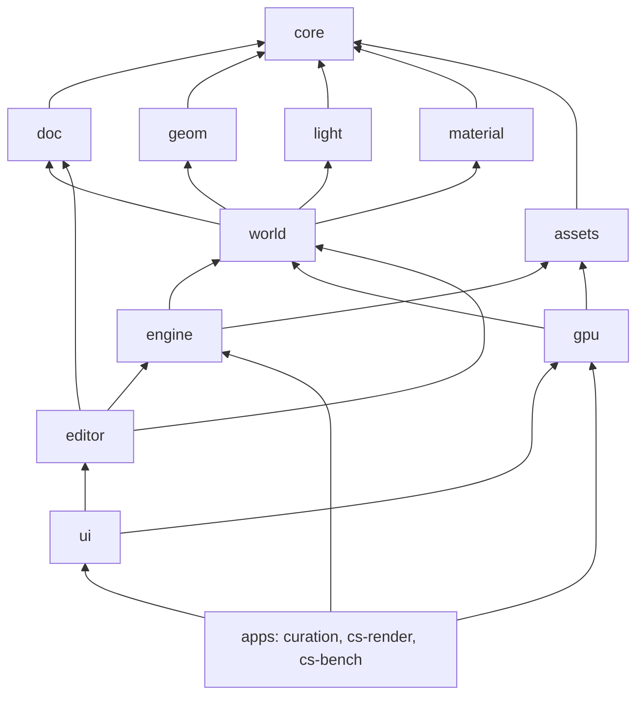
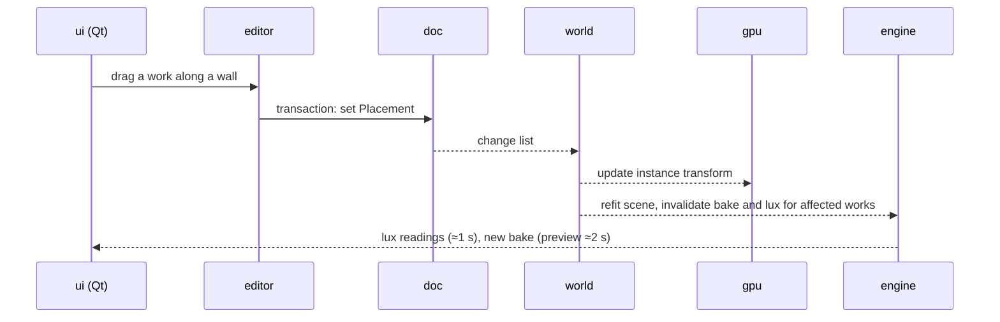

# Curation Sandbox: product blueprint

Status: **draft for approval**, 10 November 2026. Decisions link to their records in
[`docs/adr/`](../adr/). The roadmap that turns this into work is [`docs/roadmap.md`](../roadmap.md).

## 1. The product in one paragraph

Curation Sandbox is a desktop application in which a curator builds an exhibition space, hangs
artworks at their true size in frames, lights them with real museum fixtures, and sees the
result rendered with physically based light: what the works will look like, and how many lux
fall on each one. It replaces paper maquettes, elevation drawings in PowerPoint and guesswork
about light with one model that is to scale, lit in real units and quick to change. It is free,
open-source software under the Apache-2.0 licence, for Windows and Linux.

## 2. Who it is for

**First users: institutional curators** planning a temporary exhibition or a rehang of a
collection gallery, and the exhibition designers and registrars who work with them. The owner
knows several museum curators who will try early builds (see section 11).

What they need from a tool, in order:

1. **Scale they can trust.** Works at their true size, walls and heights in centimetres,
   measurements they can quote to a technician.
2. **Light they can trust.** Real fixtures, real beam shapes, and an illuminance reading on each
   work that they can hold against conservation limits (typically 50 lux for works on paper and
   textiles, 150 to 200 lux for oil paintings).
3. **Speed.** A 40-work hang drafted in an afternoon, not a week; a change of wall colour or
   fixture seen at once.
4. **Something to show.** Stills for a director or a lender, a hanging list and wall elevations
   for the installation team.

Later users, who the product should not shut out: commercial galleries and independent
curators, exhibition designers who now use SketchUp or Vectorworks, students of curatorial
studies, and lighting designers who want a gallery-specific tool lighter than DIALux.

## 3. The journeys that matter most

Each journey is the test of a milestone: a curator from section 11 must be able to finish it
without help, and the roadmap's exit criteria measure it.

**J1. Draft the hang of a 40-work show in an existing room.** Enter the room's dimensions (or
draw its walls with typed lengths), mark the doorways, set the ceiling height; walls are
lettered A, B, C as on a plan. Import the exhibition checklist as a CSV exported from the
collection system (title, artist, size, medium), so the works arrive with their sizes before
any image is found, and add more from the catalogue or from image files. Hang them on a centre
line of 150 cm (a project setting) with snapping to the line, to equal gaps and to the
neighbour's edges, and type exact numbers while dragging. Walk through at eye height and check
sight lines through doorways. Export wall elevations and a hanging list.

**J2. Light the show and check every work against its limit.** Place a lighting track where
the Canadian Conservation Institute's rule puts it (distance from the wall = (ceiling height −
1.6 m) × tan 30°), add spotlights from a fixture library (real products, real photometric
files), aim each at a work at the conventional 30 degrees from vertical, dim and change beam
angle. Read the lux on every work, see which exceed the target for their sensitivity (50 lux
for works on paper, 150 to 200 lux for oil paintings), and the yearly exposure in lux-hours
from the opening hours. Export a lighting schedule.

**J3. Import a work in under a minute.** Drop an image file on a wall. Type its true size. Pick
a medium and finish ("oil on canvas, varnished", "watercolour on paper") and say whether it is
glazed. The work hangs at its size in a default frame with a material that follows from the
answers. The app says how sharp the image will look at true size, and warns when it is too
small to show detail up close.

**J4. Show the draft to someone else.** Save viewpoints, render each as a high-quality still
with the reference path tracer, and export them with the hanging list, so that a director,
lender or technician sees the same thing the curator does.

**J5. Explore without a brief.** Build a space from nothing: change wall colours and heights,
try a salon hang, swap a work, duplicate the project as a variant and compare. Everything can
be undone.

## 4. Where the brief needed changing

The brief is the vision; these are the places where it was vague, contradicted itself or asked
for something unrealistic, and what the plan does instead.

| The brief says | The problem | What the plan does |
| --- | --- | --- |
| "Everything ray traced", and also "high frames even on lower quality machines". | Full real-time path tracing does not run on integrated GPUs, and is not needed for most of what a curator checks. | Quality tiers (section 6): the light a curator measures (direct illuminance on each work) is exact in every tier; ray tracing adds soft shadows, reflections in glazing and bounced light where the GPU can afford it; a progressive path tracer makes the stills and is the reference every tier is tested against. |
| "Extremely accurate" reflection off paintings. | Undefined, so untestable. | Accuracy is stated as numbers: the calculation engine within 1% of analytic answers; the real-time tiers' lux within 2% (direct light) and 5% (mean) of the engine; appearance compared with golden images (section 6). |
| "We need information like the type of paint used." | Pigment-level data exists for almost no works, and a photograph already carries the colour. What paint changes is gloss, varnish and surface relief. | A small set of medium-and-finish presets (oil varnished, acrylic matte, watercolour, pastel and so on) sets a layered material. An import asks three questions, with defaults (ADR 0003). |
| ML to "improve the quality of uploaded images". | Upscaling invents detail, and a curator needs a faithful reproduction. | No generative upscaling in the MVP. The app reports the effective resolution at true size and warns when it is low. Opt-in upscaling, labelled as enhanced on screen and in exports, is reconsidered after 1.0 (ADR 0005). |
| "High detail textures" and "efficient memory usage". | A few hundred works at full resolution are tens of gigabytes. | Compressed GPU textures with mip chains, a texture budget per tier, a bundled starter set and on-demand download of the rest (ADR 0004). |
| Build rooms "completely from the ground up" and also draft for "a specific project". | A specific project happens in an existing building, whose plan the curator has as a drawing. | Rooms are built from typed dimensions in the MVP; tracing over a scaled floor-plan image comes in 1.0; importing CAD or BIM files is after 1.0. |
| Sculpture later, "build with this in mind". | Easy to say, easy to break. | A painting is one kind of exhibit in the data model from the first commit, and the first non-painting exhibit (a plinth or bench) ships in 1.0 to prove it (ADR 0008). |

## 5. Scope

### MVP: the curator alpha (end of milestone 4)

Everything needed for journeys J1 to J4 in one room or a few connected rooms:

- **Space:** rooms from dimensions; free walls drawn with typed lengths; doorways as openings;
  ceiling height; wall, floor and ceiling colours and finishes.
- **Works:** a bundled catalogue of 30 to 50 public-domain works with metadata, materials and
  credit lines; import of PNG, JPEG and TIFF images with true size, medium, finish and glazing;
  import of an exhibition checklist as CSV, with images matched by file name or added later
  (a work without an image hangs as a labelled placeholder of the right size).
- **Frames:** six parametric styles (for example gilded swept, flat black, natural oak, white
  box, metal strip, unframed with a mat for works on paper), each resized to any work, with a
  mat (passe-partout) and glazing as options.
- **Hanging:** centre-line hanging, snapping to the line, to equal spacing and to neighbours'
  edges; numeric position entry; distribute and align commands; dimensions shown while dragging.
- **Light:** a library of about ten real museum fixtures with IES files (spot, flood, wall
  washer, framing projector), plus generic fixtures in lumens and beam angle; track placement;
  aim at a work; dimming, and "dim to target" (set a fixture so its work receives its target
  lux); colour temperature. Lux on every work, conservation classes and yearly lux-hours.
- **Rendering:** the Standard tier (rasterised, with exact direct light and baked indirect
  light) and the Path-traced tier on the CPU for stills (section 6).
- **Navigation:** orbit, walk at eye height, plan view and wall elevation view.
- **Project:** save and open, autosave and crash recovery, unlimited undo and redo, project
  variants by duplication.
- **Exports:** stills (PNG, and EXR for the linear image), a hanging list (CSV and PDF), wall
  elevations and a floor plan (PDF and SVG), a lighting schedule (CSV).
- **Platforms:** Windows 10 and 11, and Linux (x86-64), from portable builds and installers.

### Explicit non-goals of the MVP

Sculpture, furniture and other 3D exhibits; daylight, windows and skylights; importing CAD,
BIM or 3D models; walkthrough video; machine learning of any kind except the path tracer's
denoiser; wall texts and labels; collaboration, cloud storage or accounts; VR; macOS; spectral
rendering and colour-rendering metrics for fixtures; localisation (English only).

### 1.0

- The **Ray-traced tier** on GPUs with hardware ray tracing: ray-traced soft shadows,
  reflections in glazing and varnish, dynamic bounced light.
- A **GPU path tracer** for stills, many times faster than the CPU reference.
- **Floor-plan underlay**: trace walls over a scaled image or PDF of an existing plan.
- **First non-painting exhibits:** plinths, benches and vitrines, from a small library.
- **Daylight:** windows and skylights with a sun and sky for a place and date.
- **Walkthrough video** along a camera path.
- **Catalogue of about 300 works**, downloaded on demand.
- **Wall texts and labels**, with their sizes.
- Signed installers, automatic update checks, a user guide.

### After 1.0

Sculpture from scanned or modelled 3D files; macOS; opt-in ML upscaling with labelling;
spectral rendering and fixture colour quality (CRI, TM-30); IFC and DXF import; sharing a
read-only walkthrough; VR; localisation.

## 6. Quality tiers and performance budgets

Full reasoning in [ADR 0002](../adr/0002-rendering-tiers.md). The principle: **lux is
calculated, not read off the screen.** A CPU path tracer (the *calculation engine*) computes
every lux reading and is the reference for every display tier, so the numbers are equally
trustworthy on an office laptop and on a gaming PC; only the picture differs.

| Tier | What it is | Minimum specification | Reference hardware | Frame-rate target (1080p, 50-work gallery) | When |
| --- | --- | --- | --- | --- | --- |
| **Standard** | Rasterised; exact direct light from every IES fixture; soft shadow maps; indirect light baked by the engine; reflection probes | Vulkan 1.3, 2 GB video memory (shared allowed): Intel Iris Xe, AMD integrated, GTX 1050 | Radeon 780M; an Intel Iris Xe laptop | 60 fps on the 780M; 30 fps on Iris Xe | MVP |
| **Ray-traced** | Hybrid: ray-traced soft shadows and reflections, dynamic indirect light, in-house denoiser; converges to the path-traced image when still | `VK_KHR_ray_query`, 6 GB: RTX 2060, RX 6600, Arc | RTX 2060; RTX 40-series | 60 fps on the RTX 2060 | 1.0 |
| **Path-traced** | Progressive path tracer for stills, denoised with OIDN: the engine on the CPU (MVP), a GPU version (1.0) | any x86-64 CPU; GPU version needs ray queries | Ryzen 7 8840U; RTX 2060 | n/a: see still budgets | MVP (CPU), 1.0 (GPU) |

**Budgets.** Each is measured by a benchmark (section 9) on a fixed scene: `empty-room` (one
room, one work, one light) and `gallery-50` (two rooms, 50 framed works with 4k textures, 40
spotlights).

| Budget | Standard tier | Ray-traced tier |
| --- | --- | --- |
| Frame time, 95th percentile over a scripted 20 s walk, `gallery-50` at 1080p | ≤ 16.7 ms on the 780M; ≤ 33 ms on Iris Xe | ≤ 16.7 ms on the RTX 2060 |
| Frame time, `empty-room` at 1080p | ≤ 8 ms on the 780M | ≤ 8 ms on the RTX 2060 |
| GPU memory, `gallery-50` | ≤ 1.5 GB | ≤ 3 GB |
| Peak process memory, `gallery-50` | ≤ 2 GB | ≤ 2.5 GB |
| Open `gallery-50` to first frame (textures cached) | ≤ 3 s | ≤ 3 s |
| Start the app to first frame (shader cache warm) | ≤ 2 s | ≤ 2 s |
| Indirect light after an edit (Ryzen 7 8840U) | preview ≤ 2 s, full ≤ 30 s, no frame over budget meanwhile | dynamic |
| Lux on every work after an edit, standard error ≤ 2% | ≤ 1 s | ≤ 1 s |
| Still, 1080p, 64 samples per pixel, denoised | ≤ 60 s on the Ryzen 7 8840U | ≤ 10 s on the RTX 2060 |
| Still, 4K, 256 samples per pixel, denoised | ≤ 15 min on the Ryzen 7 8840U | ≤ 2 min on the RTX 2060 |

**Accuracy**, stated as tolerances that tests check: the engine within 1% of analytic answers
(inverse-square, cosine law, a fixture's total lumens) and of the white furnace; the Standard
tier's lux within 2% of the engine for direct light and 5% on average; images compared with the
engine's reference by NVIDIA FLIP, mean at most 0.10 for Standard and 0.05 for Ray-traced.

## 7. Architecture

### Modules

C++20 libraries under `libs/`, each with `include/cs/<module>/`, `src/` and `tests/`, in
namespace `cs::<module>`. A module may depend only on the modules listed for it, and sees only
their headers, not their dependencies'. A module may re-export a listed dependency whose types
appear in its public headers, so that the modules depending on it see that dependency too;
everything else stays private. Re-exports are marked *(re-exported)* below.

| Module | Responsibility | May depend on | External libraries |
| --- | --- | --- | --- |
| `core` | units, photometry, colour (sRGB, colour temperature, exposure), maths, seeded random numbers, the linear `Image`, logging, a thread pool | nothing | glm |
| `doc` | the document (ADR 0008), the mutation API, transactions, undo and redo, JSON and the `.curation` container, schema migrations | core | nlohmann/json, miniz |
| `geom` | meshes from rooms, walls and openings; parametric frames, mats and glazing; lightmap charts | core | |
| `light` | IES LM-63 parsing, photometric distributions (evaluate, sample, integrate), fixture library, conservation policy and exposure | core | |
| `material` | `PaintingMaterial`, presets, finish-to-roughness mapping, the reference BRDF (evaluate, sample, pdf) | core | |
| `assets` | image import with colour management, linearisation, mips, KTX2 encoding, the texture cache, catalogue manifest and verification | core | stb_image, libtiff, lcms2, KTX-Software |
| `world` | compiles the document into the render world (meshes, instances, materials, lights, cameras) and updates it from each transaction's change list | core, doc, geom *(re-exported)*, light, material | |
| `engine` | the calculation engine: Embree scene, path tracer, lux meter, baker, still renderer, denoising | core, world, light, material, assets | Embree, OIDN |
| `gpu` | the Vulkan renderer: device, memory, swapchain and offscreen targets, texture residency, the Standard tier, later Ray-traced and GPU path tracing; shaders in `libs/gpu/shaders/` | core, world, light, material, assets | volk, vk-bootstrap, VMA, Slang |
| `editor` | everything a curator does, without a UI: tools, commands, selection, snapping, measuring, camera controllers, checklist import, exports as CSV and drawing display lists | core, doc, world, geom, light, material, assets, engine | |
| `ui` | the Qt Widgets shell, panels and the viewport adapter | editor, gpu, assets, core | Qt 6 |

Applications under `apps/`: `curation` (the desktop app), `cs-render` (headless: render a
project at a tier to EXR or PNG and print a lux report as JSON; used by tests, skills and
benchmarks) and `cs-bench` (runs a benchmark scene and writes timings and memory as JSON).



Hard rules, enforced by the build (each module links only what it declares, and passes on only
what it re-exports) and by review:
only `gpu` and the viewport adapter in `ui` include Vulkan; only `ui` and `apps/curation`
include Qt; only `doc` knows the file format; nothing changes the document except through the
mutation API; the engine and the GPU tiers read the render world, never the document.

### How an edit flows



The UI thread owns the document. Each committed transaction produces an immutable revision of
the render world; the engine's jobs (lux, bake, stills) run on a worker pool against a revision
and are cancelled or discarded when a newer one supersedes it.

### Files and layout

```text
libs/<module>/{include/cs/<module>/,src/,tests/}   one CMakeLists.txt each: cs_add_module(...)
libs/gpu/shaders/          Slang shaders, compiled at build time
apps/{curation,cs-render,cs-bench}/
data/{fixtures,frames,presets,finishes}/   built-in library: one JSON (and IES) file per item
catalogue/                 selection.toml, manifest.json, credits (images live in releases)
tools/catalogue/           the catalogue pipeline (Python)
tests/scenes/              test projects as unpacked folders, readable in diffs
tests/golden/              reference images per scene, tier and driver
tests/integration/         tests that compare modules: the only test executable that links several
bench/{scenes,baselines}/, bench/budgets.json
docs/{product,adr,roadmap}/, docs/dependencies.md
```

Project files: `Name.curation`, a zip of `manifest.json`, `project.json` and content-addressed
assets ([ADR 0007](../adr/0007-project-files-undo-exports.md)). Data model:
[ADR 0008](../adr/0008-exhibit-data-model.md).

**Built for parallel work.** Each module's `CMakeLists.txt` is a single `cs_add_module` call
that globs its sources and tests, so adding a file never edits a shared list. Built-in fixtures,
frames, presets, benchmark scenes and golden tests are directories of one file per item,
discovered at run time or configure time, so two tasks adding items do not collide.

## 8. Decisions

| # | Decision | Record |
| --- | --- | --- |
| 1 | Build the renderer: C++20, Vulkan 1.3, Slang, Embree; vcpkg; Godot runner-up | [0001](../adr/0001-engine.md) |
| 2 | A CPU calculation engine for lux and reference; Standard, Ray-traced and Path-traced display tiers with budgets and tolerances | [0002](../adr/0002-rendering-tiers.md) |
| 3 | A layered material (base, varnish coat, gilding, fuzz, glazing), twelve presets, a four-question import; CIE 157 conservation classes; six frame styles | [0003](../adr/0003-painting-materials.md) |
| 4 | Catalogue from Cleveland, the Met, NGA, Rijksmuseum and SMK; a rights rule; 40 bundled works, the rest from GitHub Releases | [0004](../adr/0004-catalogue.md) |
| 5 | Open Image Denoise for stills; no generative upscaling; an effective-resolution warning instead | [0005](../adr/0005-machine-learning.md) |
| 6 | Qt 6 Widgets around a Vulkan viewport; placement and snapping conventions | [0006](../adr/0006-ui-and-interaction.md) |
| 7 | `.curation` zip with JSON; undo by recorded patches; autosave journal; exports | [0007](../adr/0007-project-files-undo-exports.md) |
| 8 | Works as records; entities with components; placement as its own component | [0008](../adr/0008-exhibit-data-model.md) |
| 9 | Windows and Linux; Apache-2.0; portable builds for the alpha | [0009](../adr/0009-platforms-licence-distribution.md) |

Deferred, with a date: macOS (spike before the 1.0 planning); spectral rendering and colour
quality (after 1.0); super-resolution (after 1.0, if curators ask); the first users' date or event
(none set; revisit after the first curator session).

### What is kept from the learning project, and what is dropped

| Kept | Why |
| --- | --- |
| `core/include/cs/core/photometry.hpp` and its tests | The unit conventions (nits, candela, lux) are the product's; the functions become the analytic answers in accuracy tests. |
| `cs::Image` and `linear_to_srgb8` | A linear-light image is what the engine accumulates; it gains EXR and PNG output. |
| The inverse-square and white furnace checks from `docs/milestone-1.md` | They become the engine's first accuracy tests (milestone 1). |
| The virtual lux meter design (cosine-weighted hemisphere sampling, π × mean luminance) | It is the engine's lux meter. |
| CMake presets (debug with sanitizers, release, profile), the `cs_options` target, warnings, `.clang-format`, Catch2 | Sound basics; they move into the new layout. |
| CI on Linux and Windows plus a sanitizer job | Extended with caching, formatting, lavapipe and the task-file check. |

| Dropped | Why |
| --- | --- |
| `apps/pt` (renders a gradient) | Replaced by `cs-render`, which removed it (M1-17, #153). |
| `docs/milestone-1.md` | A learning guide ("type every line yourself", six learning milestones, a 31 January 2027 checkpoint). Deleted rather than archived, so that agents searching the repository are not misled by it; git history keeps it. |
| The six-milestone learning roadmap in the README | Replaced by [the roadmap](../roadmap.md). |
| "CPU path tracer first, as a learning step" | The CPU engine stays, for product reasons (ADR 0002), but is built alongside the GPU path, not before it. |
| Catch2 through FetchContent, hand-maintained source lists | vcpkg and globbing modules (section 7). |

`docs/notes/` stays: it is the owner's learning log, which still has value as a side benefit.
Agents never write there.

## 9. Verification built in from the start

- **Determinism.** All random numbers come from a counter-based generator seeded by (scene
  seed, pixel, sample, bounce), so a render is identical whatever the thread count, and tests
  compare exact outputs where they can.
- **Accuracy tests** on the engine (CPU, every CI run): inverse-square, cosine law, a uniform
  cone and an IES fixture against their lumens, the white furnace, a lux meter against the
  analytic answer; later, the Standard tier's lux grid against the engine.
- **Golden images.** Small references (128 to 256 px, tens of kilobytes) per scene, tier and
  driver in `tests/golden/`, compared with FLIP and a mean-error tolerance. They change only in
  a pull request that says why.
- **GPU in CI** on Mesa lavapipe (software Vulkan with ray queries), the Mesa version pinned;
  validation layers on, and any validation message fails the test.
- **Benchmarks.** `cs-bench` runs `empty-room` and `gallery-50` at each tier and writes frame
  times, memory and load times as JSON; `bench/budgets.json` holds the budgets of section 6;
  `bench/baselines/<machine>/<scene>-<tier>.json` the last accepted numbers. CI runs them for correctness and
  memory; frame times are checked on the owner's machines with `/perf-check`.
- **Untrusted input.** Every parser (project files, IES, images, checklists, catalogue
  manifests) has bounds checks, a fuzz target and a security review.

## 10. Risks

| Risk | Likelihood, impact | Spike or mitigation |
| --- | --- | --- |
| Qt and the Vulkan viewport do not cooperate (Wayland, high DPI, input capture) | medium, high | The Qt viewport spike in the first week; fallbacks in ADR 0006 |
| The custom renderer takes much longer than planned | medium, high | Walking skeleton first; ADR 0001's revisit trigger (skeleton over budget by half → reconsider Godot for display) |
| Lavapipe in CI is too slow, drifts between Mesa versions, or is unavailable on Windows | medium, medium | The CI GPU spike in milestone 1; tiny images; pinned Mesa; per-driver references |
| The Standard tier cannot match the engine within tolerance (baked light on frames, light leaks) | medium, high | Spike in milestone 3 (lightmaps against probes for frames and works); the lux numbers come from the engine regardless |
| Integrated GPUs run out of memory with many large works | medium, high | Texture residency by on-screen size from milestone 2; `gallery-50` memory benchmark in CI |
| Errors every tier shares (fixtures as points, photograph albedo, real lamp output) | high, medium | Spike in milestone 4: measure a real gallery with a lux meter, with a curator, and compare (owner task) |
| Manufacturers' IES files cannot be redistributed | medium, medium | Spike in milestone 3; fallback: generic fixtures plus importing a curator's own IES files |
| Museum IT blocks unsigned or admin installers | high, high | Portable builds without administrator rights; apply for free open-source signing in milestone 3 (ADR 0009) |
| Curators value different things than assumed (lux, accuracy, exports) | medium, high | Sessions after milestones 1 and 2, before the alpha (section 11) |
| Museum dimension data is wrong (framed sizes, swapped axes) | high, medium | Pipeline checks against image aspect ratios; manual review of every starter-set work |
| Agent-written physics passes its own tests but is wrong | medium, high | Independent `test-author`, `physics-reviewer` on every lighting change, analytic and furnace tests |
| Review time is the bottleneck | high, medium | Tasks sized for 10 to 20 minutes of review; every acceptance criterion automated; `/code-review` before the owner sees a pull request |
| Driver differences (RADV, NVIDIA, Intel on Windows) | medium, medium | Validation layers; test builds on friends' machines at each milestone; an optional nightly self-hosted runner |

## 11. Getting it in front of curators

The owner knows several institutional curators. Plan:

1. **After milestone 1 (walking skeleton):** a 30-minute call with two or three of them. Show
   the skeleton; ask how they plan a hang today, what they hand to technicians, what machines
   they have (hardware decides the tier budgets), and whether they can share a past show's
   checklist and floor plan. With permission, that show becomes a test and benchmark scene.
2. **After milestone 2 (build and hang):** hands-on sessions on the owner's laptop. A curator
   does journey J1 while thinking aloud; time it and note every place they get stuck.
3. **Curator alpha (end of milestone 4):** portable builds on their own machines; journeys J1 to
   J4 unsupervised; a short questionnaire; logs shared on request.

What their feedback can change:

| If curators say or show | The plan changes |
| --- | --- |
| Their machines have ray-tracing GPUs more often than assumed | The Ray-traced tier moves earlier |
| Their machines are older than Iris Xe | The Standard tier's budgets and minimum specification drop |
| They always start from a PDF floor plan | Floor-plan underlay moves into the MVP |
| Many use Macs | The macOS spike moves before 1.0 |
| Lux readings do not change their decisions | The Ray-traced tier and lighting depth lose priority to hanging and exports |
| Their collection systems export checklists differently | The checklist importer gains mappings |
| They ask for sharper imports | The opt-in super-resolution decision (ADR 0005) is revisited |

Each piece of feedback becomes an issue; `/groom` weighs it against the roadmap weekly.

## 12. Glossary

- **Centre line:** the height of the centres of hung works above the floor, typically 145 to
  155 cm.
- **Illuminance (lux):** light falling on a surface, lumens per square metre.
- **IES file:** a manufacturer's measurement of how a fixture's intensity varies with direction
  (IES LM-63 text format).
- **Calculation engine:** the CPU path tracer that computes lux and reference images.
- **Render world:** the renderer-neutral scene compiled from the document.
- **Tier:** a display quality level (Standard, Ray-traced, Path-traced).

