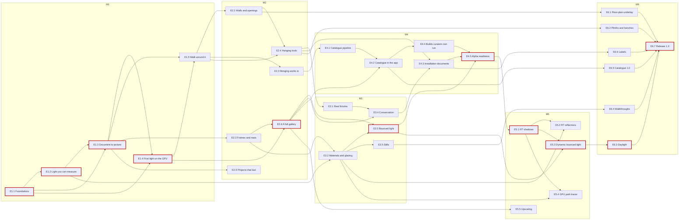
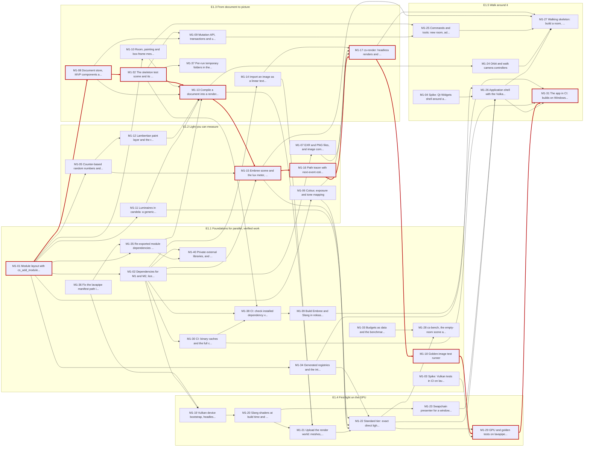
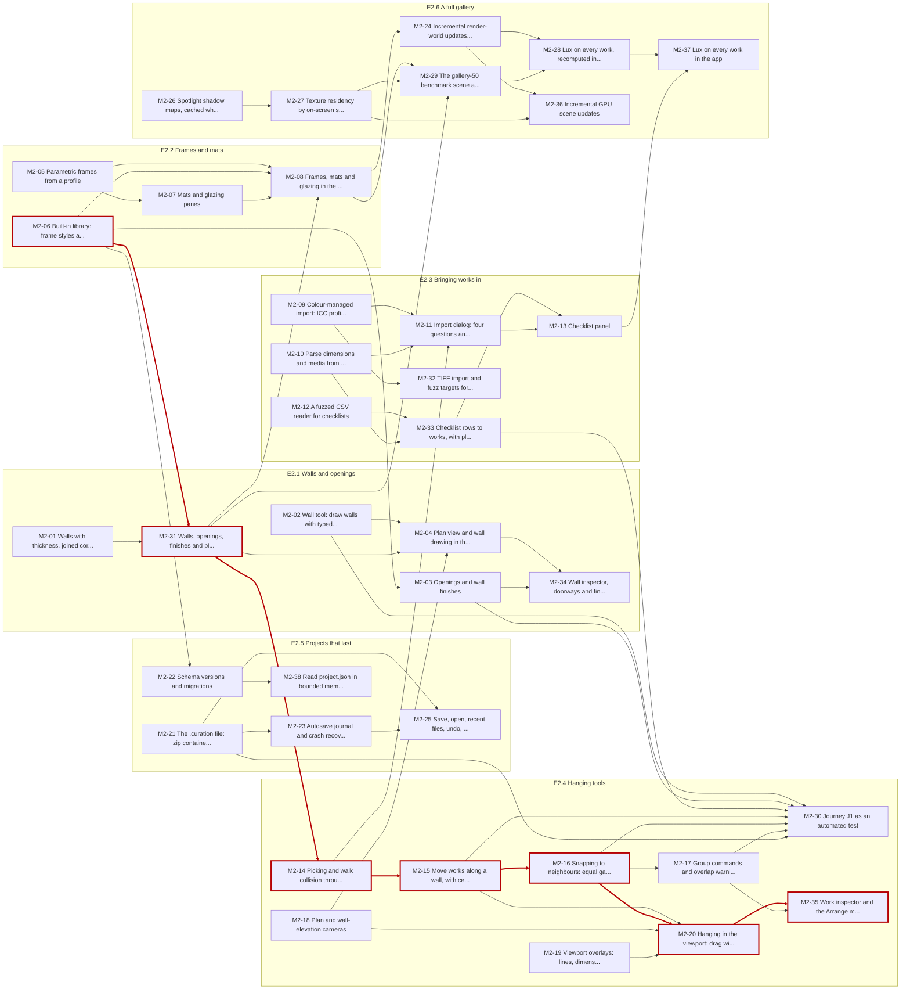

# Roadmap

Status: **draft for approval**, 10 November 2026. The product is described in the
[blueprint](product/blueprint.md); decisions are in [`docs/adr/`](adr/). Once the GitHub issues
exist, **the issues are the source of truth for task status**; this page is the high-level
picture, and `/groom` updates its progress section weekly.

## How the work is cut

- **Milestones** are usable increments of the product, each ending in something a curator could
  try, with exit criteria stated as checks.
- **Epics** are feature areas of a handful of tasks; each ends with a screenshot or render.
- **Tasks** are one session, one branch, one pull request: 50 to 400 changed lines of non-test
  code, reviewable in 10 to 20 minutes, each with an automated check that fails before it and
  passes after. They live in [`roadmap/tasks.toml`](roadmap/tasks.toml) and become GitHub
  issues through `scripts/github-bootstrap.py`.
- **Planning horizon:** milestones 1 and 2 are decomposed into tasks now. Later milestones stay
  at epic level; `/groom` decomposes each when the one before it is about 70% done.
- **Walking skeleton first.** Milestone 1 builds every layer thinly (document, geometry, light,
  engine, GPU, app) and proves the whole path; later milestones deepen every part.

## Milestones

| Milestone | Goal | Journeys | Tasks | Target date |
| --- | --- | --- | --- | --- |
| [M1 Walking skeleton](#m1-walking-skeleton) | The app opens, a room is built, one painting hangs at true size under one spotlight in candela, you walk around and read its lux | first steps of J1, J2 | 34 | 4 Dec 2026 |
| [M2 Build and hang](#m2-build-and-hang) | Walls, frames, imports and checklists, hanging with snapping, save, undo and recovery, a 50-work gallery in budget | J1, J3; J5's undo and Save As | 37 | 8 Jan 2027 |
| [M3 Light it right](#m3-light-it-right) | Real fixtures, painting materials and glazing, bounced light, conservation, stills | J2, J4 (stills) | about 32 | 12 Feb 2027 |
| [M4 Curator alpha](#m4-curator-alpha) | The catalogue, installation documents, portable builds; v0.1.0 to curators | J1 to J4 | about 32 | 19 Mar 2027 |
| [M5 Ray-traced tier](#m5-ray-traced-tier) | Ray-traced shadows, reflections and bounced light; the GPU path tracer | all, faster and finer | about 28 | 30 Apr 2027 |
| [M6 Release 1.0](#m6-release-10) | Floor-plan underlay, plinths and benches, daylight, walkthroughs, 300 works, labels, signed installers; v1.0.0 | all | about 40 | 25 Jun 2027 |

## Epic dependencies

The **critical path** (red) runs through the light: foundations, the calculation engine, the
GPU tier, the full gallery, bounced light, the alpha, then the ray-traced tier and daylight.
Editor epics run beside it in other lanes.

## M1 Walking skeleton

**Goal.** The app opens, a room is built, one painting hangs at its true size under one
spotlight given in candela, you walk around it and read its lux. Every layer exists thinly, and
the harness that later tasks rely on (module layout, golden images, benchmarks, GPU tests in CI)
is in place.

**Exit criteria**, each delivered by the tasks named:

| # | Check | Delivered by |
| --- | --- | --- |
| 1 | CI passes on Linux (GCC; Clang with sanitizers) and Windows (MSVC) with warnings as errors, the format check and the dependency check | M1-01, M1-02, M1-30 |
| 2 | Adding a source or test file to any module, or an entry to a registry, needs no CMake edit (`cmake_module_glob` and `cmake_registry` tests) | M1-01, M1-34 |
| 3 | Engine accuracy: inverse-square 250 lux, cosine 125 lux and a 15° cone 1167.7 lux, each within 1%; white furnace 100 nits within 1% | M1-15, M1-16 |
| 4 | Engine renders and lux readings are bit-identical with 1 and 8 threads | M1-15, M1-16 |
| 5 | Undo: 1000 random transactions undone serialise byte-identical to the start | M1-09 |
| 6 | Standard tier: illuminance at the painting's centre within 2% of the engine's direct value; zero validation messages on lavapipe and the 780M | M1-19 to M1-23 |
| 7 | Golden images `skeleton-path` (CPU) and `skeleton-standard` (lavapipe in CI, RADV locally) pass; Standard against the engine's direct render, mean FLIP at most 0.05 | M1-18, M1-29 |
| 8 | In the app (UI test): build a room, hang a 73 × 92 cm painting, light it; the lux panel equals `cs-render`'s report within 1% | M1-27 |
| 9 | `empty-room` at 1080p on the 780M: 95th-percentile frame time at most 8 ms, checked by `perf-compare.py` against `bench/budgets.json` and saved as the first baseline | M1-28, M1-33 |
| 10 | The Qt viewport and GPU-CI spikes are decided (ADR 0010, ADR 0011) | M1-03, M1-04 |
| 11 | The app builds on Windows and Linux in CI, and its UI tests run headless on lavapipe | M1-31 |

**Owner activity:** after the milestone, a 30-minute call with two or three curators
(blueprint, section 11).

### Tasks

Bold IDs are on the critical path.

| ID | Title | Area | Type | Size | Owner | Blocked by | Touches |
| --- | --- | --- | --- | --- | --- | --- | --- |
| **M1-01** | Module layout with cs_add_module, presets and a vcpkg baseline | build | chore | M | agent | - | `CMakeLists.txt`, `CMakePresets.json`, `cmake/CsModule.cmake`, `cmake/CsOptions.cmake`, `cmake/tests/`, `vcpkg.json`, `vcpkg-configuration.json`, `core/`, `tests/CMakeLists.txt`, `tests/test_image.cpp`, `tests/test_photometry.cpp`, `libs/`, `apps/CMakeLists.txt`, `apps/pt/CMakeLists.txt`, `tools/sanitizers/`, `.github/workflows/ci.yml`, `.gitignore`, `README.md` |
| M1-02 | Dependencies for M1 and M2, licence files and the dependency policy | build | chore | M | agent | M1-01 | `vcpkg.json`, `vcpkg-configuration.json`, `libs/core/CMakeLists.txt`, `libs/engine/CMakeLists.txt`, `libs/gpu/CMakeLists.txt`, `libs/assets/CMakeLists.txt`, `libs/doc/CMakeLists.txt`, `third_party/`, `docs/dependencies.md`, `scripts/check-dependencies.py`, `scripts/tests/test_check_dependencies.py`, `LICENSE`, `NOTICE` |
| M1-03 | Spike: Vulkan tests in CI on lavapipe | gpu | spike | S | agent | - | `docs/adr/0010-gpu-tests-in-ci.md` |
| M1-04 | Spike: Qt Widgets shell around a Vulkan viewport | ui | spike | M | agent | - | `docs/adr/0011-qt-vulkan-viewport.md` |
| M1-05 | Counter-based random numbers and sampling functions | core | feature | S | agent | M1-01 | `libs/core/include/cs/core/random.hpp`, `libs/core/include/cs/core/sampling.hpp`, `libs/core/src/sampling.cpp`, `libs/core/tests/test_random.cpp`, `libs/core/tests/test_sampling.cpp` |
| M1-06 | Colour, exposure and tone mapping | core | feature | M | agent | M1-01 | `libs/core/include/cs/core/colour.hpp`, `libs/core/src/colour.cpp`, `libs/core/include/cs/core/math.hpp`, `libs/core/tests/test_colour.cpp`, `libs/core/tests/test_math.cpp` |
| M1-07 | EXR and PNG files, and image comparison with FLIP | core | feature | M | agent | M1-02 | `libs/core/include/cs/core/image_io.hpp`, `libs/core/src/image_io.cpp`, `libs/core/include/cs/core/image_compare.hpp`, `libs/core/src/image_compare.cpp`, `libs/core/tests/test_image_io.cpp`, `libs/core/tests/test_image_compare.cpp`, `libs/core/tests/data/` |
| **M1-08** | Document store, MVP components and project folders | doc | feature | M | agent | M1-01 | `libs/doc/include/`, `libs/doc/src/`, `libs/doc/tests/` |
| M1-09 | Mutation API, transactions and undo | doc | feature | M | agent | M1-08, M1-32 | `libs/doc/include/cs/doc/document.hpp`, `libs/doc/src/document.cpp`, `libs/doc/include/cs/doc/transaction.hpp`, `libs/doc/src/transaction.cpp`, `libs/doc/include/cs/doc/history.hpp`, `libs/doc/src/history.cpp`, `libs/doc/tests/test_transaction.cpp`, `libs/doc/tests/test_history.cpp`, `libs/doc/include/cs/doc/project_io.hpp`, `libs/doc/src/project_io.cpp` |
| M1-10 | Room, painting and box-frame meshes | geom | feature | M | agent | M1-01 | `libs/geom/include/`, `libs/geom/src/`, `libs/geom/tests/` |
| M1-11 | Luminaires in candela: a generic spotlight | light | feature | S | agent | M1-01 | `libs/light/include/`, `libs/light/src/`, `libs/light/tests/` |
| M1-12 | Lambertian paint layer and the reference BRDF interface | material | feature | S | agent | M1-05 | `libs/material/include/`, `libs/material/src/`, `libs/material/tests/` |
| **M1-13** | Compile a document into a render world | world | feature | M | agent | M1-08, M1-10, M1-11, M1-12, M1-32, M1-35 | `libs/world/include/`, `libs/world/src/`, `libs/world/tests/` |
| M1-14 | Import an image as a linear texture with mipmaps | assets | feature | S | agent | M1-02 | `libs/assets/include/`, `libs/assets/src/`, `libs/assets/tests/` |
| **M1-15** | Embree scene and the lux meter, with analytic accuracy tests | engine | feature | M | agent | M1-13, M1-05, M1-02 | `libs/engine/include/cs/engine/scene.hpp`, `libs/engine/src/scene.cpp`, `libs/engine/include/cs/engine/lux.hpp`, `libs/engine/src/lux.cpp`, `libs/engine/tests/test_scene.cpp`, `libs/engine/tests/test_lux.cpp`, `libs/core/include/cs/core/thread_pool.hpp`, `libs/core/src/thread_pool.cpp`, `libs/core/tests/test_thread_pool.cpp` |
| **M1-16** | Path tracer with next-event estimation and the white furnace test | engine | feature | M | agent | M1-15 | `libs/engine/include/cs/engine/path_tracer.hpp`, `libs/engine/src/path_tracer.cpp`, `libs/engine/tests/test_path_tracer.cpp` |
| **M1-17** | cs-render: headless renders and lux reports; remove pt | engine | feature | M | agent | M1-16, M1-07, M1-06, M1-14 | `apps/cs-render/`, `apps/pt/`, `libs/engine/include/cs/engine/textures.hpp`, `libs/engine/src/textures.cpp`, `libs/engine/tests/test_textures.cpp`, `README.md`, `libs/engine/include/cs/engine/work_lux.hpp`, `libs/engine/src/work_lux.cpp`, `libs/engine/tests/test_work_lux.cpp` |
| **M1-18** | Golden-image test runner | build | test | M | agent | M1-17 | `cmake/CsGolden.cmake`, `apps/cs-render/`, `tests/golden/` |
| M1-19 | Vulkan device bootstrap, headless, with validation as test failure | gpu | feature | M | agent | M1-02, M1-36 | `libs/gpu/include/cs/gpu/device.hpp`, `libs/gpu/src/device.cpp`, `libs/gpu/tests/test_device.cpp`, `libs/gpu/tests/main.cpp`, `.claude/agents/gpu-reviewer.md`, `tools/sanitizers/lsan.supp` |
| M1-20 | Slang shaders at build time and an offscreen triangle | gpu | feature | M | agent | M1-19 | `cmake/CsShaders.cmake`, `libs/gpu/CMakeLists.txt`, `libs/gpu/shaders/`, `libs/gpu/include/cs/gpu/pipeline.hpp`, `libs/gpu/src/pipeline.cpp`, `libs/gpu/include/cs/gpu/offscreen.hpp`, `libs/gpu/src/offscreen.cpp`, `libs/gpu/tests/test_offscreen.cpp` |
| M1-21 | Upload the render world: meshes, materials and textures | gpu | feature | M | agent | M1-20, M1-13, M1-14 | `libs/gpu/include/cs/gpu/scene.hpp`, `libs/gpu/src/scene.cpp`, `libs/gpu/src/upload.cpp`, `libs/gpu/tests/test_scene.cpp` |
| M1-22 | Standard tier: exact direct light from spotlights | gpu | feature | M | agent | M1-21, M1-06, M1-11, M1-15, M1-34 | `libs/gpu/shaders/standard.slang`, `libs/gpu/shaders/common/`, `libs/gpu/include/cs/gpu/standard_tier.hpp`, `libs/gpu/src/standard_tier.cpp`, `libs/gpu/tests/test_standard_tier.cpp`, `tests/integration/test_standard_vs_engine.cpp` |
| M1-23 | Swapchain presenter for a window surface | gpu | feature | S | agent | M1-20 | `libs/gpu/include/cs/gpu/presenter.hpp`, `libs/gpu/src/presenter.cpp`, `libs/gpu/tests/test_presenter.cpp` |
| M1-24 | Orbit and walk camera controllers | editor | feature | S | agent | M1-13 | `libs/editor/include/cs/editor/camera_controller.hpp`, `libs/editor/src/camera_controller.cpp`, `libs/editor/tests/test_camera_controller.cpp` |
| M1-25 | Commands and tools: new room, add a painting, light it | editor | feature | M | agent | M1-09, M1-10 | `libs/editor/include/cs/editor/commands/`, `libs/editor/src/commands/`, `libs/editor/include/cs/editor/tool.hpp`, `libs/editor/src/tool.cpp`, `libs/editor/tests/test_commands.cpp`, `libs/editor/tests/test_tool.cpp` |
| M1-26 | Application shell with the Vulkan viewport | ui | feature | M | agent | M1-04, M1-22, M1-23, M1-34 | `libs/ui/`, `apps/curation/`, `cmake/CsQt.cmake` |
| M1-27 | Walking skeleton: build a room, hang a painting, light it, walk | ui | feature | M | agent | M1-26, M1-24, M1-25, M1-15, M1-17 | `libs/ui/src/features/skeleton_commands.cpp`, `libs/ui/src/features/camera_input.cpp`, `libs/ui/src/features/lux_panel.cpp`, `libs/ui/tests/test_walking_skeleton.cpp`, `.claude/agents/ux-reviewer.md`, `docs/product/screens/m1-walking-skeleton.png` |
| M1-28 | cs-bench, the empty-room scene and the first baseline | build | test | M | agent | M1-22, M1-33 | `apps/cs-bench/`, `bench/scenes/empty-room/`, `bench/baselines/` |
| **M1-29** | GPU and golden tests on lavapipe in CI | build | test | S | agent | M1-03, M1-18, M1-22 | `.github/workflows/gpu.yml`, `apps/cs-render/`, `tests/golden/skeleton-standard/` |
| M1-30 | CI: binary caches and the full compiler matrix | build | chore | S | agent | M1-02 | `.github/workflows/ci.yml` |
| **M1-31** | The app in CI: builds on Windows and Linux, UI tests on lavapipe | build | chore | S | agent | M1-26, M1-29, M1-30, M1-39 | `.github/workflows/ci.yml`, `.github/workflows/gpu.yml` |
| **M1-32** | The skeleton test scene and its test chart | doc | test | S | agent | M1-08 | `tests/scenes/skeleton/`, `tools/test-chart/`, `libs/doc/tests/test_skeleton_scene.cpp` |
| M1-33 | Budgets as data and the benchmark comparison script | build | test | S | agent | - | `bench/budgets.json`, `scripts/perf-compare.py`, `scripts/tests/test_perf_compare.py` |
| M1-34 | Generated registries and the integration-test executable | build | chore | S | agent | M1-01 | `cmake/CsRegistry.cmake`, `cmake/CsIntegration.cmake`, `tests/integration/` |
| M1-35 | Re-exported module dependencies (EXPORTS in cs_add_module) | build | chore | S | agent | M1-01, M1-36 | `cmake/CsModule.cmake`, `cmake/tests/module_glob.cmake`, `cmake/tests/module_glob/`, `libs/world/CMakeLists.txt`, `docs/product/blueprint.md`, `CLAUDE.md` |
| M1-36 | Fix the lavapipe manifest path in CLAUDE.md and /ship | gpu | chore | S | agent | - | `CLAUDE.md`, `.claude/skills/ship/SKILL.md` |
| M1-37 | Per-run temporary folders in the doc tests | doc | bug | S | agent | M1-32 | `libs/doc/tests/test_project_io.cpp`, `libs/doc/tests/test_skeleton_scene.cpp`, `libs/doc/tests/temp_folder.hpp` |
| M1-38 | CI: check installed dependency versions and test the test chart | build | chore | S | agent | M1-30, M1-32, M1-02 | `.github/workflows/ci.yml` |
| M1-39 | Build Embree and Slang in release only, through overlay triplets | build | chore | S | agent | M1-38 | `triplets/`, `vcpkg-configuration.json`, `.github/workflows/ci.yml`, `docs/dependencies.md` |
| M1-40 | Private external libraries, and third_party/ from the root | build | chore | S | agent | M1-35, M1-02 | `cmake/CsModule.cmake`, `cmake/tests/module_glob.cmake`, `cmake/tests/module_glob/`, `CMakeLists.txt`, `third_party/`, `libs/core/CMakeLists.txt`, `libs/assets/CMakeLists.txt`, `docs/product/blueprint.md`, `CLAUDE.md` |

### Task graph

The critical path is ten tasks: the module layout, the document store, the skeleton scene, the
render world, the engine's lux meter and path tracer, `cs-render`, the golden runner, GPU tests
in CI and the app in CI. The GPU chain (M1-02, M1-19 to M1-22, M1-26, M1-27) is two tasks
shorter and runs beside it. Tests that compare modules (the GPU tier against the engine) live in
`tests/integration/`, so no module depends on another just to test it.

### Lanes in M1

A lane is a group of tasks that touch different files, so they can run in parallel sessions.

| Stage | Opens when | Lanes open (tasks) |
| --- | --- | --- |
| 0 | at once | build (M1-01, M1-33), gpu spike (M1-03), ui spike (M1-04) |
| 1 | M1-01 merged | build (M1-02, M1-34, M1-35 → M1-40), core (M1-05, M1-06), doc (M1-08), geom (M1-10), light (M1-11), gpu (M1-36, once M1-03 frees the lane), editor (M2-10, M2-12 from M2, which need only the layout) |
| 2 | M1-02, M1-05, M1-08, M1-36 merged | core (M1-07), doc (M1-32 → M1-37, M1-09), material (M1-12), assets (M1-14), gpu (M1-19 → M1-20), build (M1-30 → M1-38 → M1-39) |
| 3 | M1-13 merged | engine (M1-15 → M1-17), gpu (M1-21 → M1-22, M1-23), editor (M1-24, M1-25) |
| 4 | M1-22 merged | ui (M1-26 → M1-27), build (M1-18, M1-28, M1-29 → M1-31) |

Three sessions are never short of work after stage 0: from stage 1 on, at least five lanes are
open.

## M2 Build and hang

**Goal.** Journey J1 without the catalogue: draw walls with typed lengths and doorways, frame
works in six styles, import images and a whole checklist, hang with centre-line and neighbour
snapping, and keep the work safe with a real project file, undo, autosave and recovery. A
50-work gallery stays within its memory budget.

**Exit criteria:**

| # | Check | Delivered by |
| --- | --- | --- |
| 1 | Journey J1 as an automated test (six walls, a door, a 40-row checklist, 40 works hung and distributed, saved and reopened byte-identical) passes in under 5 s | M2-30 |
| 2 | UI tests for walls, doorways and finishes, import, checklist, hanging, the inspector, lux, and save and recovery pass offscreen in CI | M2-04, M2-34, M2-11, M2-13, M2-20, M2-35, M2-37, M2-25 |
| 3 | For a work 73 cm wide and 92 cm high: the four moulding styles give a 72 × 91 cm sight opening, the floater a 75 × 94 cm opening, the works-on-paper style a 72.2 × 91.2 cm mat window, each within 1 mm, with closed meshes | M2-05, M2-06, M2-07, M2-08 |
| 4 | `.curation` zip and folder round-trip byte-identical; atomic save survives an interrupted write; recovery after a simulated crash equals the last complete change | M2-21, M2-23 |
| 5 | Incremental world and GPU updates equal a full rebuild over random transactions; moving one work touches only its 2 to 4 instances | M2-24, M2-36 |
| 6 | `gallery-50` on lavapipe in CI: GPU memory at most 1.5 GB, and resident memory other than GPU memory at most 2 GB | M2-27, M2-29 |
| 7 | Lux on all 50 works refreshed in at most 1 s at 2% standard error on the reference CPU | M2-28 |
| 8 | Standard-tier shadows: lux on the skeleton work within 5% of the engine's direct lux | M2-26 |
| 9 | Fuzz targets for images, checklists and project files run 60 s without findings | M2-09, M2-12, M2-21 |
| 10 | `gallery-50` frame time on the 780M at 1080p is measured and recorded against the 16.7 ms budget (enforced from M4) | M2-29 |
| 11 | Free walls, doorways, finishes and placeholder works appear in every renderer; the walk camera passes through a doorway | M2-31, M2-14 |

**Owner activities:** hands-on curator sessions with J1 after the milestone; test builds on
friends' machines (an RTX 40-series PC and an Intel integrated laptop) to record their
`gallery-50` numbers.

### Tasks

| ID | Title | Area | Type | Size | Owner | Blocked by | Touches |
| --- | --- | --- | --- | --- | --- | --- | --- |
| M2-01 | Walls with thickness, joined corners and openings | geom | feature | M | agent | M1-10 | `libs/geom/include/cs/geom/walls.hpp`, `libs/geom/src/walls.cpp`, `libs/geom/tests/test_walls.cpp` |
| M2-02 | Wall tool: draw walls with typed lengths and snapping | editor | feature | M | agent | M1-25 | `libs/editor/include/cs/editor/tools/wall_tool.hpp`, `libs/editor/src/tools/wall_tool.cpp`, `libs/editor/tests/test_wall_tool.cpp` |
| M2-03 | Openings and wall finishes | editor | feature | S | agent | M1-25, M2-06 | `libs/editor/include/cs/editor/commands/openings.hpp`, `libs/editor/src/commands/openings.cpp`, `libs/editor/include/cs/editor/commands/finishes.hpp`, `libs/editor/src/commands/finishes.cpp`, `libs/editor/tests/test_openings.cpp`, `data/finishes/wall-` |
| M2-04 | Plan view and wall drawing in the app | ui | feature | M | agent | M2-02, M2-18, M2-31, M1-27 | `libs/ui/src/features/walls.cpp`, `libs/ui/src/widgets/measurements_box.cpp`, `libs/ui/include/cs/ui/widgets/measurements_box.hpp`, `libs/ui/tests/test_walls_ui.cpp`, `docs/product/screens/m2-walls.png` |
| M2-05 | Parametric frames from a profile | geom | feature | M | agent | M1-10 | `libs/geom/include/cs/geom/frame.hpp`, `libs/geom/src/frame.cpp`, `libs/geom/tests/test_frame.cpp` |
| **M2-06** | Built-in library: frame styles and finishes as data files | doc | feature | M | agent | M1-08, M1-32, M1-09 | `libs/doc/include/cs/doc/library.hpp`, `libs/doc/src/library.cpp`, `libs/doc/tests/test_library.cpp`, `data/frames/`, `data/finishes/frame-`, `libs/doc/src/project_io.cpp`, `tests/scenes/skeleton/project.json` |
| M2-07 | Mats and glazing panes | geom | feature | S | agent | M2-05 | `libs/geom/include/cs/geom/mat.hpp`, `libs/geom/src/mat.cpp`, `libs/geom/tests/test_mat.cpp` |
| M2-08 | Frames, mats and glazing in the render world | world | feature | S | agent | M2-05, M2-06, M2-07, M1-13, M2-31 | `libs/world/src/compile.cpp`, `libs/world/src/exhibits.cpp`, `libs/world/tests/test_exhibits.cpp` |
| M2-09 | Colour-managed import: ICC profiles and 16-bit images | assets | feature | M | agent | M1-14, M1-02 | `libs/assets/include/cs/assets/import.hpp`, `libs/assets/src/import.cpp`, `libs/assets/src/icc.cpp`, `libs/assets/tests/test_import_colour.cpp`, `libs/assets/tests/data/icc/` |
| M2-10 | Parse dimensions and media from museum text | editor | feature | S | agent | M1-01 | `libs/editor/include/cs/editor/parse_text.hpp`, `libs/editor/src/parse_text.cpp`, `libs/editor/tests/test_parse_text.cpp`, `libs/editor/tests/data/museum_strings.toml`, `data/presets/` |
| M2-11 | Import dialog: four questions and the resolution warning | ui | feature | M | agent | M2-09, M2-10, M1-27, M2-14 | `libs/ui/src/features/import_image.cpp`, `libs/ui/src/features/import_dialog.cpp`, `libs/ui/tests/test_import_ui.cpp`, `docs/product/screens/m2-import.png` |
| M2-12 | A fuzzed CSV reader for checklists | editor | feature | S | agent | M1-01 | `libs/editor/include/cs/editor/csv.hpp`, `libs/editor/src/csv.cpp`, `libs/editor/tests/test_csv.cpp`, `libs/editor/fuzz/fuzz_csv.cpp` |
| M2-13 | Checklist panel | ui | feature | S | agent | M2-33, M2-11 | `libs/ui/src/features/checklist_panel.cpp`, `libs/ui/tests/test_checklist_ui.cpp`, `docs/product/screens/m2-checklist.png` |
| **M2-14** | Picking and walk collision through scene queries | editor | feature | S | agent | M1-15, M1-24, M2-31 | `libs/editor/include/cs/editor/picking.hpp`, `libs/editor/src/picking.cpp`, `libs/editor/src/camera_controller.cpp`, `libs/editor/tests/test_picking.cpp`, `libs/editor/include/cs/editor/selection.hpp`, `libs/editor/src/selection.cpp`, `libs/editor/tests/test_selection.cpp` |
| **M2-15** | Move works along a wall, with centre-line snapping and typed values | editor | feature | M | agent | M2-14, M1-25 | `libs/editor/include/cs/editor/tools/hang_tool.hpp`, `libs/editor/src/tools/hang_tool.cpp`, `libs/editor/tests/test_hang_tool.cpp` |
| **M2-16** | Snapping to neighbours: equal gaps, alignment and margins | editor | feature | M | agent | M2-15 | `libs/editor/include/cs/editor/snapping.hpp`, `libs/editor/src/snapping.cpp`, `libs/editor/tests/test_snapping.cpp` |
| M2-17 | Group commands and overlap warnings | editor | feature | M | agent | M2-16 | `libs/editor/include/cs/editor/commands/arrange.hpp`, `libs/editor/src/commands/arrange.cpp`, `libs/editor/include/cs/editor/warnings.hpp`, `libs/editor/src/warnings.cpp`, `libs/editor/tests/test_arrange.cpp` |
| M2-18 | Plan and wall-elevation cameras | editor | feature | S | agent | M1-22, M1-24, M1-34 | `libs/editor/include/cs/editor/camera_views.hpp`, `libs/editor/src/camera_views.cpp`, `libs/editor/tests/test_camera_views.cpp`, `tests/integration/test_elevation_view.cpp` |
| M2-19 | Viewport overlays: lines, dimension marks, outlines and labels | gpu | feature | M | agent | M1-22, M1-29 | `libs/gpu/include/cs/gpu/overlay.hpp`, `libs/gpu/src/overlay.cpp`, `libs/gpu/src/font_atlas.cpp`, `libs/gpu/shaders/overlay.slang`, `libs/gpu/tests/test_overlay.cpp`, `libs/gpu/tests/data/overlay/`, `data/fonts/` |
| **M2-20** | Hanging in the viewport: drag with guides and the elevation view | ui | feature | M | agent | M2-15, M2-16, M2-18, M2-19, M1-27 | `libs/ui/src/features/hanging.cpp`, `libs/ui/src/features/view_menu.cpp`, `libs/ui/tests/test_hanging_ui.cpp`, `docs/product/screens/m2-hanging.png` |
| M2-21 | The .curation file: zip container with atomic save | doc | feature | M | agent | M1-09, M1-02 | `libs/doc/include/cs/doc/container.hpp`, `libs/doc/src/container.cpp`, `libs/doc/tests/test_container.cpp`, `libs/doc/fuzz/` |
| M2-22 | Schema versions and migrations | doc | feature | M | agent | M2-06, M1-34, M1-02 | `libs/doc/include/cs/doc/migrate.hpp`, `libs/doc/src/migrate.cpp`, `libs/doc/src/migrations/`, `libs/doc/CMakeLists.txt`, `libs/doc/tests/test_migrate.cpp`, `libs/doc/tests/data/migrations/`, `libs/doc/src/project_io.cpp`, `libs/doc/include/cs/doc/document.hpp`, `libs/doc/include/cs/doc/work.hpp` |
| M2-23 | Autosave journal and crash recovery | doc | feature | M | agent | M1-09, M2-21 | `libs/doc/include/cs/doc/journal.hpp`, `libs/doc/src/journal.cpp`, `libs/doc/tests/test_journal.cpp` |
| M2-24 | Incremental render-world updates from change lists | world | feature | M | agent | M1-09, M2-08 | `libs/world/include/cs/world/update.hpp`, `libs/world/src/update.cpp`, `libs/world/tests/test_update.cpp` |
| M2-25 | Save, open, recent files, undo, redo and recovery in the app | ui | feature | M | agent | M2-21, M2-23, M1-27 | `libs/ui/src/features/project_menu.cpp`, `libs/ui/src/features/edit_menu.cpp`, `libs/ui/tests/test_project_ui.cpp`, `libs/ui/src/features/file_menu.cpp`, `docs/product/screens/m2-recovery.png` |
| M2-26 | Spotlight shadow maps, cached while lights are still | gpu | feature | M | agent | M1-22, M1-29, M1-34 | `libs/gpu/include/cs/gpu/shadows.hpp`, `libs/gpu/src/shadows.cpp`, `libs/gpu/shaders/shadow.slang`, `libs/gpu/shaders/standard.slang`, `libs/gpu/src/standard_tier.cpp`, `libs/gpu/tests/test_shadows.cpp`, `tests/golden/skeleton-standard/`, `tests/integration/test_shadows_vs_engine.cpp` |
| M2-27 | Texture residency by on-screen size, within a budget | gpu | feature | M | agent | M1-21, M2-26 | `libs/gpu/include/cs/gpu/residency.hpp`, `libs/gpu/src/residency.cpp`, `libs/gpu/src/scene.cpp`, `libs/gpu/tests/test_residency.cpp`, `libs/gpu/shaders/standard.slang` |
| M2-28 | Lux on every work, recomputed in the background | engine | feature | M | agent | M1-15, M2-24, M1-28, M2-29 | `libs/engine/include/cs/engine/lux_service.hpp`, `libs/engine/src/lux_service.cpp`, `libs/engine/tests/test_lux_service.cpp`, `apps/cs-bench/` |
| M2-29 | The gallery-50 benchmark scene and a memory check in CI | build | test | M | agent | M1-28, M1-29, M2-08, M2-27, M2-31, M1-31 | `apps/cs-bench/`, `bench/baselines/`, `.github/workflows/gpu.yml` |
| M2-30 | Journey J1 as an automated test | editor | test | S | agent | M2-02, M2-03, M2-33, M2-15, M2-16, M2-17, M2-21 | `libs/editor/tests/test_journey_j1.cpp`, `libs/editor/tests/data/journeys/` |
| **M2-31** | Walls, openings, finishes and placeholders in the render world | world | feature | M | agent | M2-01, M2-06, M1-13 | `libs/world/src/compile.cpp`, `libs/world/src/walls.cpp`, `libs/world/tests/test_walls_world.cpp` |
| M2-32 | TIFF import and fuzz targets for every image loader | assets | feature | S | agent | M2-09 | `libs/assets/src/tiff.cpp`, `libs/assets/tests/test_import_tiff.cpp`, `libs/assets/tests/data/tiff/`, `libs/assets/fuzz/` |
| M2-33 | Checklist rows to works, with placeholders | editor | feature | M | agent | M2-12, M2-10, M1-25 | `libs/editor/include/cs/editor/checklist.hpp`, `libs/editor/src/checklist.cpp`, `libs/editor/tests/test_checklist.cpp`, `libs/editor/tests/data/checklists/` |
| M2-34 | Wall inspector, doorways and finishes in the app | ui | feature | S | agent | M2-04, M2-03 | `libs/ui/src/features/walls_inspector.cpp`, `libs/ui/src/features/openings_dialog.cpp`, `libs/ui/tests/test_walls_inspector_ui.cpp` |
| **M2-35** | Work inspector and the Arrange menu | ui | feature | S | agent | M2-20, M2-17 | `libs/ui/src/features/work_inspector.cpp`, `libs/ui/src/features/arrange_menu.cpp`, `libs/ui/tests/test_work_inspector_ui.cpp` |
| M2-36 | Incremental GPU scene updates | gpu | feature | M | agent | M2-24, M2-27 | `libs/gpu/src/scene.cpp`, `libs/gpu/src/scene_update.cpp`, `libs/gpu/include/cs/gpu/scene.hpp`, `libs/gpu/tests/test_scene_update.cpp` |
| M2-37 | Lux on every work in the app | ui | feature | S | agent | M2-28, M2-13 | `libs/ui/src/features/lux_bridge.cpp`, `libs/ui/src/features/checklist_panel.cpp`, `libs/ui/src/features/lux_panel.cpp`, `libs/ui/tests/test_lux_ui.cpp`, `docs/product/screens/m2-gallery-50.png` |
| M2-38 | Read project.json in bounded memory | doc | bug | M | agent | M2-22 | `libs/doc/src/project_io.cpp`, `libs/doc/include/cs/doc/project_io.hpp`, `libs/doc/tests/test_project_io_memory.cpp` |

### Task graph

Within M2 the longest chain runs from the frame and finish library through walls in the render
world, picking and selection, moving and snapping, to dragging in the app and the inspector.
Five lanes are open from the start of the milestone: geom (M2-01, M2-05), doc (M2-06, M2-21),
assets (M2-09), editor (M2-10 and M2-12 if not already done during M1), gpu (M2-26).

### Lanes in M2

| Lane | Tasks, in order |
| --- | --- |
| geom | M2-01; M2-05 → M2-07 |
| doc | M2-06 → M2-22 → M2-38; M2-21 → M2-23 |
| assets | M2-09 → M2-32 |
| world | M2-31 → M2-08 → M2-24 |
| editor | M2-10, M2-12 → M2-33; M2-14 → M2-15 → M2-16 → M2-17; M2-02, M2-03, M2-18; M2-30 last |
| gpu | M2-19; M2-26 → M2-27 → M2-36 |
| engine | M2-28 after M2-29 |
| ui | M2-11 → M2-13 → M2-37; M2-04 → M2-34; M2-20 → M2-35; M2-25 |
| build | M2-29 |

## M3 Light it right

**Goal.** Journey J2: light a show with real fixtures and check every work against its limit,
with materials and glazing that look right and stills worth showing.

| Epic | Goal |
| --- | --- |
| E3.1 Real fixtures | IES LM-63 parsing (fuzzed), about ten real museum fixtures plus generic ones, tracks by the CCI rule, aim at a work, dim to target, beam and field cones, colour temperature |
| E3.2 Painting materials and glazing | GGX dielectric and conductor lobes, varnish coat, the twelve presets, glazing kinds, gilt and wood frame finishes, in the engine and the Standard tier |
| E3.3 Bounced light | The engine bakes lightmaps and probes after each edit; the Standard tier uses them |
| E3.4 Conservation | Sensitivity classes and policies, yearly exposure, warnings, lux probes and sensors |
| E3.5 Stills | Path-traced stills from viewpoints, Open Image Denoise, progress and cancel |

**Exit criteria (to be refined when decomposed):** every library fixture's IES file integrates
to its stated lumens within 2%; CPU and GPU BRDFs agree within 1e-4; the simulated gloss meter
reproduces ADR 0003's 60° table within 2 GU; on `gallery-50` the Standard tier's lux grid is
within 5% of the engine on average and 10% at the 95th percentile, mean FLIP at most 0.10;
bake preview at most 2 s and full at most 30 s on the reference CPU (`cs-bench --bake`); a
1080p still at 64 spp with denoising in at most 60 s and a 4K still at 256 spp in at most
15 min on the reference CPU (`cs-bench --still`); lux readings
identical with the denoiser on and off; journey J2 as an automated test.

**Spikes:** which manufacturers allow their IES files to be redistributed (before E3.1);
lightmaps against probes for frames and works (before E3.3); which CIE 171 test cases can be
rebuilt and checked against Radiance. **Owner:** apply for free open-source code signing
(ADR 0009).

## M4 Curator alpha

**Goal.** Curators run journeys J1 to J4 on their own machines: the catalogue, installation
documents and builds that install without administrator rights. Tagged v0.1.0.

| Epic | Goal |
| --- | --- |
| E4.1 Catalogue pipeline | `tools/catalogue/`: selection, source adapters for the Met, Cleveland and NGA, the rights check, dimension checks, KTX2, manifest; the 40-work starter set |
| E4.2 Catalogue in the app | Browser with search and filters, hanging from the catalogue, downloads with hash checks, credit lines |
| E4.3 Installation documents | Hanging list (CSV, PDF), wall elevations and floor plan (PDF, SVG), lighting schedule (CSV), still export |
| E4.4 Builds curators can run | Portable Windows zip and Linux AppImage from tags, licences, starter set, a sample project, crash logs |
| E4.5 Alpha readiness | Preferences, the startup benchmark, budgets met on the 780M and an Iris Xe laptop, a real-gallery lux comparison, fixes from the M2 sessions |

**Exit criteria (to be refined):** all 40 starter works pass the rights and dimension checks;
export golden files (SVG compared as text, PDF by page renders) for `gallery-50`; the packaged
app renders a smoke-test scene headless in CI; `gallery-50` p95 at most 16.7 ms on the 780M and
33 ms on Iris Xe, start-up at most 2 s and open at most 3 s; journeys J1 to J4 as automated
tests; v0.1.0 released to the curators.

**Spike:** compare the app's lux with a calibrated lux meter in a real gallery, with a curator
(owner).

## M5 Ray-traced tier

**Goal.** On GPUs with ray tracing, the live view gains ray-traced soft shadows, reflections in
glazing and varnish and dynamic bounced light, and stills render on the GPU.

Epics: E5.1 Ray-traced shadows, E5.2 Reflections in glazing and varnish, E5.3 Dynamic bounced
light and denoising, E5.4 GPU path tracer, E5.5 Upscaling (FSR 3.1).

**Exit criteria (to be refined):** on the RTX 2060 at 1080p, `gallery-50` p95 at most 16.7 ms;
lux within 5% of the engine while moving and 1% once converged; mean FLIP at most 0.05; the GPU
path tracer within 1% lux and FLIP 0.02 of the engine; a 4K still at 256 spp in at most 2 min
on the RTX 2060.

**Spikes:** many-light sampling and the denoiser on the RTX 2060 and the 780M; the GPU path
tracer's structure (ray queries in compute against ray-tracing pipelines).

## M6 Release 1.0

**Goal.** The 1.0 scope of the blueprint. Tagged v1.0.0.

Epics: E6.1 Floor-plan underlay, E6.2 Plinths, benches and vitrines (the first non-painting
exhibits), E6.3 Daylight, E6.4 Walkthroughs and glTF export, E6.5 Catalogue 1.0 and HD textures,
E6.6 Labels and wall texts, E6.7 Release 1.0.

**Spikes:** virtual texturing (software page tables against sparse residency); macOS
feasibility (MoltenVK or KosmicKrisp, Qt, ray tracing).

## Every budget has a benchmark

| Budget (blueprint, section 6) | Benchmark | Measured from |
| --- | --- | --- |
| Frame time, `empty-room` | `cs-bench bench/scenes/empty-room`, compared by `perf-compare.py` | M1-28, M1-33 |
| Frame time, `gallery-50` | `cs-bench` on the generated `gallery-50` | M2-29 |
| GPU and process memory, `gallery-50` | the same run (CI on lavapipe) | M2-29 |
| Open `gallery-50` to first frame | the same run, load time | M2-29 |
| Lux on every work after an edit | `cs-bench --lux` | M2-28 |
| Indirect light after an edit | `cs-bench --bake` | M3 (E3.3) |
| Stills, 1080p and 4K | `cs-bench --still` | M3 (E3.5); GPU in M5 |
| Start the app to first frame | `curation --benchmark-startup` | M4 (E4.5) |
| Ray-traced tier budgets | `cs-bench --tier raytraced` | M5 |

Frame times are checked on real hardware with `/perf-check` (the 780M and the RTX 2060
locally; friends' machines at milestone ends); memory and correctness in CI.

## Spikes

| Spike | When | Decides | Record |
| --- | --- | --- | --- |
| Vulkan tests in CI on lavapipe | M1-03 | How GPU tests and goldens run in CI | ADR 0010 |
| Qt Widgets around a Vulkan viewport | M1-04 | Confirms or replaces the toolkit | ADR 0011 |
| IES file licences | M3 | Which real fixtures ship | ADR |
| Lightmaps against probes for frames and works | M3 | How the Standard tier gets bounced light | ADR |
| CIE 171 cases and Radiance | M3 | Which external validation the engine runs | ADR |
| Real-gallery lux comparison | M4 | Whether shared errors (fixtures as points, photograph albedo) need work | report and ADR |
| Many-light sampling and denoising | M5 | The Ray-traced tier's lighting | ADR |
| GPU path tracer structure | M5 | Megakernel or wavefront; ray queries or pipelines | ADR |
| Virtual texturing | M6 | HD textures | ADR |
| macOS | M6 | Whether 1.x adds macOS | ADR |

Risks without a spike have mitigations in the [blueprint](product/blueprint.md#10-risks).

## Timeline

Estimated from scratch for this way of working:

- **Throughput:** about 15 merged tasks a week. The owner reviews about 10 hours a week; a
  pull request takes 20 to 30 minutes including the occasional second round, and `/groom`,
  curator sessions and spike reading take the rest. Three sessions can produce more than that;
  review is the limit.
- **Critical path:** M1's longest chain is ten tasks; at about one task a day on the chain
  (session, review, merge), M1 takes two to three weeks even with spare throughput.
- **Start:** Monday 16 November 2026, once the three planning pull requests are merged and the
  issues exist.
- **Breaks:** none planned except 24 December to 3 January.

| Milestone | Tasks | Weeks | Window |
| --- | --- | --- | --- |
| M1 | 34 | 3 | 16 Nov to 4 Dec 2026 |
| M2 | 37 | 3.5 | 7 Dec 2026 to 8 Jan 2027 (with the break) |
| M3 | about 32 | 5 | 11 Jan to 12 Feb 2027 |
| M4 | about 32 | 5 | 15 Feb to 19 Mar 2027 (curator alpha) |
| M5 | about 28 | 6 | 22 Mar to 30 Apr 2027 |
| M6 | about 40 | 8 | 3 May to 25 Jun 2027 (1.0) |

Later milestones carry more slack: they include spikes whose outcome is unknown and the first
curator feedback. `/groom` recalculates the dates from the measured throughput after M1, and the
milestones on GitHub move with it.

## Progress

Updated by `/groom`.

| Milestone | Done | Open | In progress | Notes |
| --- | --- | --- | --- | --- |
| M1 | 0 | 34 | 0 | not started |
| M2 | 0 | 37 | 0 | not started |

## The task file

[`roadmap/tasks.toml`](roadmap/tasks.toml) holds labels, milestones, epics and the tasks of the
decomposed milestones. Each task has: `id` (`M2-07`), `epic`, `title`, `area` (a lane label),
`type`, `size`, `owner`, `blocked_by` (task IDs), `touches` (files and directories the task may
change), `goal`, `context`, `acceptance` (checks), `out_of_scope`, `verification` (commands), and
optionally `verification_visual` and, for size L, `design_note`.

- `python3 scripts/github-bootstrap.py --check` validates it: every field present, no cycles,
  spikes naming their record, L tasks with a design note, and tasks that may run in parallel not
  touching the same files.
- `--table M1` and `--graph M1` print the tables and graphs on this page.
- `--show M1-07` prints the issue body exactly as it will be created.
- Status lives on the issues, not in this file: the labels `in-progress`, `blocked` and
  `priority:high` (a ready task that `/dispatch` takes before the others).
- Without flags the script prints a dry run against GitHub; `--apply` creates what is missing.
